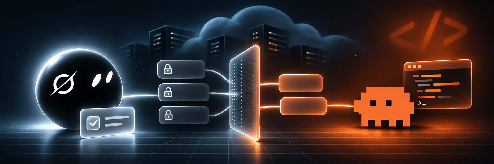

# usta



Run **your own Claude Code** on **Grok Bot's cloud computer**, and decide exactly what of yours goes there.

Grok Bot is a good manager: always on, reachable from your phone, good at research and routines. For writing code, many people prefer Claude Code. usta connects the two: a Grok bot hands a coding task to Claude Code on the bot's computer, Claude Code works in your repo on a branch, and the bot reports back. You approve the push.

> Türkçe: [README.tr.md](README.tr.md)
>
> Not affiliated with xAI or Anthropic. usta installs the official, unmodified Claude Code and signs in with **your own** Claude subscription.

## What makes it different: you choose what goes

Grok Bot's computer is **shared by all your bots**. Anything you put there, every bot can read. So usta starts from *nothing*:

- **Opt-in only.** No memory folder, skill, agent or command is uploaded unless you pick it.
- **Your never-list.** Company names, clients, people: lines that contain them are removed. A markdown heading that matches drops its whole section.
- **Categories to watch.** Work, health, finance, family, clients: lines that look like these are flagged for your review.
- **Personal data check.** Emails, phone numbers, IBANs, national ID and card numbers (checksum-validated) are flagged or redacted.
- **Secrets never leave.** Provider tokens and `KEY=value` literals are masked; `.env`, settings, MCP configs, hooks and chat transcripts are always skipped.
- **Preview first.** `build --dry-run` shows what goes, what was left out and why, and what needs review. Nothing is written until you approve. Later runs show what changed since last time.

## How it works

```
your machine                         Grok Bot cloud computer
────────────                         ───────────────────────
usta_export.py  ── bundle ──▶ private repo ──▶ setup.sh
(you choose + preview)                         Claude Code + your filtered memory/skills
                                               usta-run <repo> '<task>'   (bot calls this)
                                               usta-push <repo> <branch>  (after you approve)
```

1. **On your machine:** `export/usta_export.py` builds a bundle from `~/.claude` (memory, skills, agents, commands) with your rules, and you push it to a private repo you own.
2. **On the cloud computer:** `bin/setup.sh` installs Claude Code, pulls your bundle, clones the repos you allowed, and writes a `CLAUDE.md` with environment rules.
3. **Day to day:** a Grok bot runs `usta-run <repo> '<task>'`. Claude Code works headless inside that repo, commits on a branch, and returns a short JSON result. `git push` is blocked; `usta-push` pushes a non-protected branch only after you say so.

## Quick start

Let an agent do it: give it this repo and point it at **[AGENTS.md](AGENTS.md)**. The protocol makes it read the scripts, explain them and ask before every step that matters.

By hand:

```bash
# 1. on your machine
python3 export/usta_export.py inventory                # what could go
python3 export/usta_export.py init                     # pick + never-list -> exclude.local.toml
python3 export/usta_export.py build --dry-run          # preview
python3 export/usta_export.py build --approve          # write bundle/
# copy bundle/ into a PRIVATE repo of yours and push it

# 2. on Grok Bot's cloud computer (ask your bot to run these)
#    put secrets in Grok's Vault first (see below), then:
cp usta.env.example /workspace/usta/usta.env           # edit: bundle repo, git identity
cp repos.example.txt /workspace/usta/repos.txt         # edit: repos Claude may work on
bash bin/setup.sh
usta-run my-repo 'Add a dark mode toggle. Commit on a new branch.'
```

Requirements: Python 3.11+ on your machine (3.9+ with `tomli`), a Claude Pro/Max subscription, a Grok Bot plan.

## Secrets

Put these in Grok Bot's **Vault** yourself. Never paste them into a chat.

| Name | What | Scope |
|---|---|---|
| `CLAUDE_CODE_OAUTH_TOKEN` | run `claude setup-token` on your machine, sign in with **your personal** account | your Claude subscription |
| `GH_TOKEN` | GitHub fine-grained token | only the repos in `repos.txt`, **Contents: Read and write** |
| `BUNDLE_TOKEN` | GitHub fine-grained token (optional) | only your bundle repo, **Contents: Read-only** |

Two GitHub tokens because a fine-grained token applies one permission set to every repo you select: one token would give write access to your bundle too. If the Vault can't expose secrets as environment variables, scripts also read `$USTA_ROOT/secrets/<NAME>` (mode 600).

## Terms of use (read this)

Anthropic's [legal and compliance page](https://code.claude.com/docs/en/legal-and-compliance) allows signing in to the unmodified Claude Code binary with your own subscription, including where a platform hosts it. It also says:

- the subscription is for **you**: don't share it, resell it or serve other people's requests with it;
- advertised Pro/Max limits assume **ordinary, individual usage**; usta is not a way around them;
- third parties may not collect your Claude session tokens. usta never does; you create the token and store it in your own Vault.

Check the current terms yourself; they can change.

## Safety notes

- **Shared computer.** Every Grok bot can reach what's installed. Tell your other bots not to call Claude Code, or add a Grok custom rule *Use Claude Code → Ask first* (every run then waits for your tap).
- **Prompt injection.** Repo files, issues and web pages are untrusted. Claude Code is told to treat them as data; `curl`, `ssh`, `git push` and reading the secrets folder are denied. `npm`, `node` and `python3` are allowed, so only list repos you own.
- **Egress country.** The cloud computer's IP changes. `usta-run` checks the country before every run and refuses unsupported regions.
- **Resets.** The cloud computer can be reset; run `setup.sh` again. It is idempotent.

More in [SECURITY.md](SECURITY.md).

## Configuration

Non-secret settings live in `$USTA_ROOT/usta.env` (see [usta.env.example](usta.env.example)). Export rules live in `exclude.local.toml` (see [export/exclude.example.toml](export/exclude.example.toml)); keep that file out of every repo, because it lists the names you want hidden.

| Variable | Default | Purpose |
|---|---|---|
| `USTA_ROOT` | `/workspace/usta` | kit, repos, logs, Claude config |
| `USTA_BUNDLE_REPO` / `USTA_BUNDLE_PATH` | – / `bundle` | your private bundle repo and folder |
| `USTA_REPOS_FILE` | `$USTA_ROOT/repos.txt` | repos Claude Code may work on |
| `USTA_BLOCKED_COUNTRIES` | `CN HK MO RU BY IR KP SY CU` | egress countries that cancel a run |
| `USTA_PROTECTED_BRANCHES` | `main master production prod` | branches `usta-push` refuses |
| `USTA_ALLOWED_TOOLS` / `USTA_DENIED_TOOLS` | see `bin/usta-run` | Claude Code tool permissions |
| `USTA_TIMEOUT` / `USTA_MAX_TURNS` | `1800` / `40` | per-run limits |
| `USTA_ANTHROPIC_SKILLS` | `docx pdf pptx xlsx skill-creator` | public skills added from anthropics/skills |

## Status

Early (v0.1). The export tool and scripts are covered by tests (`pytest`, `tests/test_scripts.sh` with a fake Claude and local git repos). Known gaps: no wake-up webhook when a long task finishes (the bot has to check back), one Claude account only.

## Development

```bash
uv run --with pytest pytest tests/
bash tests/test_scripts.sh
shellcheck -x bin/* tests/*.sh
```

## Credits

Ideas this builds on, found in the Grok Bot community:
[trevin's Claude Code + Codex setup prompt](https://x.com/trevin/status/2111155498879963167) (user-space install, humans do the logins),
the egress-country check suggested under [this thread](https://x.com/xiaomovps/status/2117177889414410553),
[robbin/grokbot-local-agent](https://github.com/robbin/grokbot-local-agent) (task IDs and webhook wake-ups),
and [GrokBotRadar's Ask-first tip](https://x.com/GrokBotRadar/status/2113918744540135852).

## License

MIT
